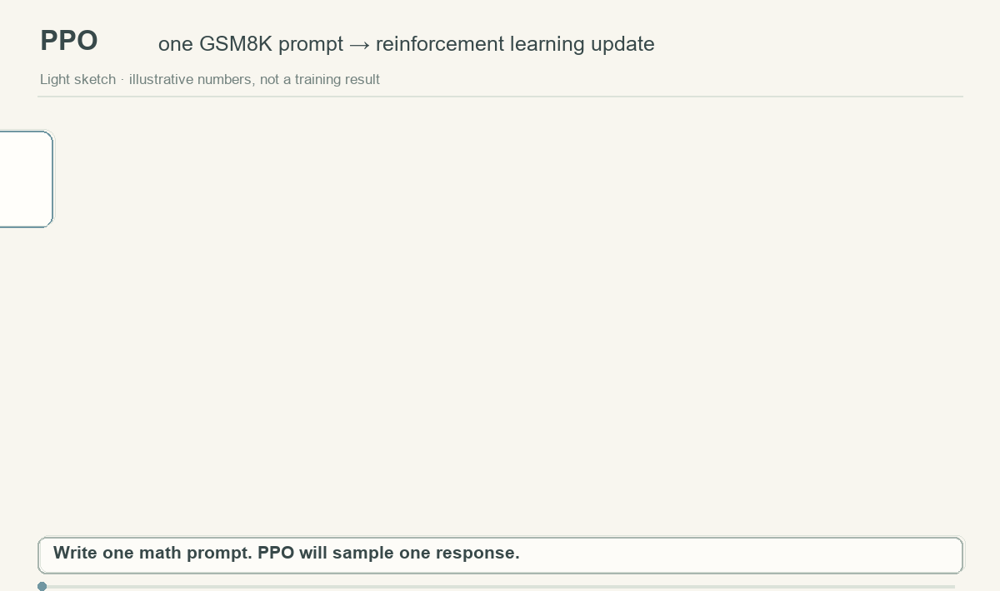
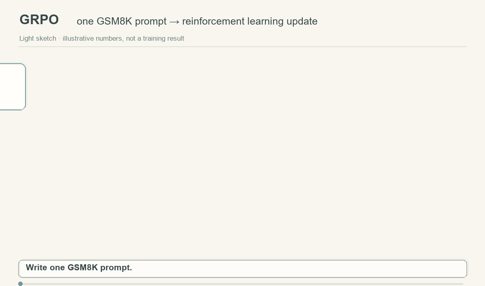

# Chapter 9: Understanding PPO and GRPO for LLMs with GSM8K

[English](README_en.md) | [简体中文](README.md)

This chapter connects the policy gradients, value functions, and advantage estimates of the earlier chapters to language models. Using [Qwen2.5-0.5B-Instruct](https://huggingface.co/Qwen/Qwen2.5-0.5B-Instruct) and [GSM8K](https://github.com/openai/grade-school-math), it explains the principles and code flow of PPO and GRPO from prompt sampling through reward and advantage computation to policy updates.

## From a prompt to a policy update: animated diagrams

These two animations demonstrate the PPO and GRPO training flows. Answer pieces appear in sequence, followed by rewards and advantages; the loss is then backpropagated to update the policy. PPO samples one answer for a prompt, while GRPO samples a group of answers to the same prompt.

**PPO:** Sample one answer for one prompt. The final answer receives a 0/1 reward, while the critic (a value head in this code) estimates values for intermediate generated states. GAE combines the terminal reward with these estimates to calculate each token's advantage backward through the response. Token logits yield log probabilities for the clipped loss; backpropagation updates both policy and value head.



**GRPO:** Generate a group of answers to the same prompt, score each answer, compute group-relative advantages, and update the policy with clipping and reference-policy KL—without training a value head.



## Task and reward

Each GSM8K record has a `question` and an `answer`. The reference answer ends with `#### number`, and the prompt asks the model to use the same final-answer format. The rule-based reward is deliberately simple:

```text
R(x, y) = 1  if the generated final number matches the reference
        = 0  otherwise
```

Here `x` is a question and `y` is a generated solution. Only training records update the policy; the test split is reserved for final-answer accuracy. The reward checks the final number, not the validity of the intermediate reasoning.

## PPO: a value head and token-level advantages

PPO samples one answer per question under the current policy. It stores the old policy's token log probabilities, and keeps a frozen copy of the initial model as a reference. The answer reward is added to the final valid token, while each token may receive a KL cost relative to the reference policy:

```text
r_t = -β [log π_old(a_t | s_t) - log π_ref(a_t | s_t)]
      + 1[t = T] · R(x, y)
```

A linear value head on the language model's last hidden state acts as the critic and estimates `V(s_t)` for each generated state. The terminal task reward and each token's KL cost form `r_t`. Generalized Advantage Estimation (GAE) works backward to obtain each token's advantage and return target:

```text
δ_t = r_t + γ V(s_{t+1}) - V(s_t)     (value after the terminal state is 0)
A_t = δ_t + γλ A_{t+1}                (recurse backward through tokens)
G_t = A_t + V(s_t)
```

The update compares the current policy with the saved old policy and clips their probability ratio. The value head learns the return target:

```text
ρ_t   = exp[log π_θ(a_t | s_t) - log π_old(a_t | s_t)]
L_PPO = -mean_t min[ρ_t A_t, clip(ρ_t, 1−ε, 1+ε) A_t]
        + (c_v / 2) · mean_t [V_θ(s_t) − G_t]²
```

`src/ppo.py` covers generation, reward and KL construction, GAE, policy and value updates, and saving. PPO trains the extra value head.

## GRPO: relative rewards within a question

GRPO samples `G` answers to the **same** question and compares their rewards within that group:

```text
mean reward R̄ = mean(R_1, ..., R_G)
group advantage A_i = (R_i − R̄) / [std(R_1, ..., R_G) + ε]
```

Each valid token in an answer receives its answer's advantage. The policy objective uses the old-policy probability ratio, clipping, and a KL term against the frozen reference. It first averages over tokens within each answer and then over answers in the group:

```text
ρ_i,t  = exp[log π_θ(a_i,t | s_i,t) − log π_old(a_i,t | s_i,t)]
L_GRPO = −mean_i mean_t min[ρ_i,t A_i, clip(ρ_i,t, 1−ε, 1+ε) A_i]
         + β · mean_i mean_t KL_i,t
Δ_i,t  = log π_ref(a_i,t | s_i,t) − log π_θ(a_i,t | s_i,t)
KL_i,t = exp(Δ_i,t) − Δ_i,t − 1
```

GRPO does not train a value head. If every answer in a group gets the same reward, its group-relative advantages are zero, so reward design and answer diversity affect the update signal.

`src/grpo.py` implements grouped generation, reward comparison, clipped updates, and saving.

## Files

```text
Chapter9_LLM_RL_GSM8K/
├── README.md / README_en.md     # Theory and usage in Chinese and English
├── requirements.txt             # Only torch and transformers
├── assets/                      # PPO / GRPO training-flow GIFs
├── data/                        # Downloaded train.jsonl and test.jsonl (ignored)
├── outputs/                     # Saved policies and predictions (ignored)
├── scripts/
│   ├── download_gsm8k.py        # Download original JSONL using the standard library
│   ├── train_ppo.sh
│   ├── train_grpo.sh
│   └── evaluate.sh
└── src/
    ├── data.py                  # JSONL loading
    ├── reward.py                # #### final-answer extraction and reward
    ├── modeling.py              # Prompts, sampling, token scores, saving
    ├── ppo.py                   # Value head, GAE, PPO update
    ├── grpo.py                  # Group advantages and GRPO update
    └── evaluate.py              # Exact final-answer accuracy on the test split
```

## Usage

Run these commands from the **repository root**. This chapter directly requires only PyTorch and Transformers; the download script uses the Python standard library. It does not require `datasets`, `trl`, `accelerate`, or `peft`.

```bash
pip install -r Chapter9_LLM_RL_GSM8K/requirements.txt

python Chapter9_LLM_RL_GSM8K/scripts/download_gsm8k.py

python -m Chapter9_LLM_RL_GSM8K.src.ppo --steps 20
python -m Chapter9_LLM_RL_GSM8K.src.grpo --steps 20 --group-size 4

python -m Chapter9_LLM_RL_GSM8K.src.evaluate \
  --model Chapter9_LLM_RL_GSM8K/outputs/grpo \
  --predictions Chapter9_LLM_RL_GSM8K/outputs/grpo_test_predictions.jsonl
```

The default model is `Qwen/Qwen2.5-0.5B-Instruct`. Training defaults to the first 64 training questions and 20 updates. Options such as `--model`, `--max-examples`, `--max-new-tokens`, and `--learning-rate` control the demo. PPO saves the policy plus `value_head.pt`; GRPO saves the policy only. Evaluation loads only the policy. The Bash wrappers provide equivalent entry points, for example `bash Chapter9_LLM_RL_GSM8K/scripts/train_grpo.sh --steps 20`.

## Running and implementation notes

- Updating a 0.5B model while keeping a reference copy uses substantial memory. This code does not add LoRA, distributed training, or memory optimization.
- The chapter uses a final-answer reward. If all answers in a GRPO group get the same score, the group-relative advantages are zero and this update receives no relative-reward policy signal.
- If generation reaches EOS early, only the first EOS is treated as a valid token; subsequent padding is ignored.

## References

- [Official GSM8K repository and data format](https://github.com/openai/grade-school-math)
- [Qwen2.5-0.5B-Instruct model card](https://huggingface.co/Qwen/Qwen2.5-0.5B-Instruct)
- [Original PPO paper](https://arxiv.org/abs/1707.06347)
- [DeepSeekMath / GRPO paper](https://arxiv.org/abs/2402.03300)
