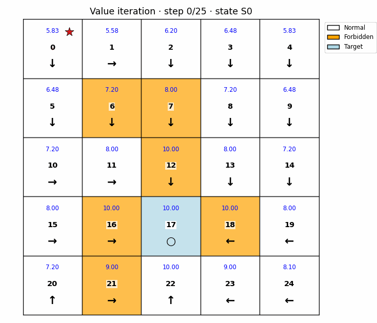

# Foundations-of-RL-Learning-From-Scratch

> 🎯 从零开始构建强化学习基础算法学习库 | 🧠 理解经典RL算法的核心原理与实践

[]()
[](LICENSE)
[](https://www.python.org/downloads/)
[]()

[English](README_en.md) | [简体中文](README.md)

---

## 📋 目录
- [🌟 项目简介](#-项目简介)
- [✨ 项目亮点](#-项目亮点)
- [📚 知识梳理文档](#-知识梳理文档)
- [🚀 快速开始](#-快速开始)
- [🧩 环境与依赖](#-环境与依赖)
- [🧭 网格世界与交互式可视化](#-网格世界与交互式可视化)
- [🧠 第 9 章：从传统 RL 到 LLM RL](#-第-9-章从传统-rl-到-llm-rl)
- [🏗️ 项目结构与算法概览](#-项目结构与算法概览)
- [📖 核心学习资源](#-核心学习资源)
- [📄 许可证](#-许可证)

## 🌟 项目简介

### 📈 为什么学习强化学习？

近年来，强化学习在大型语言模型（LLM）领域大放异彩，从 ChatGPT 的 RLHF（基于人类反馈的强化学习）o1系列到DeepSeek 的 R1系列，RL 已成为提升大语言模型对齐性、安全性和推理能力的关键技术。但要深入理解现代 RL 如何训练 LLM，最好的方式就是从头学习强化学习的经典算法发展脉络。

**Foundations-of-RL-Learning-From-Scratch** 是一个教学性质的、从零实现的强化学习基础算法库。本项目的目标是：**通过简洁、清晰、可运行的代码，帮助学习者直观地理解强化学习核心算法的原理、推导与实现细节**。

项目从基础的网格世界环境、贝尔曼方程开始，逐步实现策略迭代、价值迭代、蒙特卡洛、时序差分、价值函数近似与策略梯度算法；第 9 章进一步给出语言模型中 PPO、GRPO 的教学流程。前八章的实验模块包含：
- 📖 **完整的代码实现** 与 **详尽的注释**
- 💻 **可执行的测试示例**
- 🛠️**支持调整关键参数（如学习率、折扣因子、探索率等）**
- 📊 **学习过程与结果的可视化**
- 📚 **中英文知识梳理 PDF 文档**：系统总结每章理论、代码实现、实验设置与结果解读，方便从传统 RL 过渡到 LLM RL 相关学习。

## ✨ 项目亮点
- **代码驱动学习**：拒绝“黑箱”，每个算法都有手把手实现的代码，可逐行调试。
- **统一的网格世界环境**：前八章的网格世界算法可在同一个简单环境中对比和理解；第 9 章单独使用 GSM8K。
- **结构清晰，循序渐进**：章节安排符合经典教材的学习路径，从基础到进阶。
- **理论与实践结合**：代码实现紧密配合《强化学习的数学原理》等权威教材。
- **双语知识文档**：新增中文与英文两个版本的知识梳理 PDF，围绕每章“理论基础、实现内容、实验目的、结果解读”进行系统总结。

## 🧭 网格世界与交互式可视化

下面的动图来自[第 3 章的价值迭代实验](Chapter3_Policy_and_Value_Iteration/README.md)，展示状态价值与策略随迭代更新的过程。蓝色数值表示状态价值，箭头表示当前策略；网格沿用原有配色：白色为普通状态，橙色为惩罚状态，浅蓝色为目标状态。



要交互式运行其他章节的算法，请从仓库根目录启动面板：

```bash
pip install -r requirements.txt
streamlit run apps/gridworld_lab/app.py
```

在左侧面板中选择章节和算法后，可以调整网格大小、起点、目标与惩罚状态、奖励、折扣因子、学习率、探索率和训练回合数。运行后，网格颜色区分状态类型，蓝色数值显示该算法的状态价值或动作价值摘要，箭头显示策略动作，红线显示智能体轨迹；下方的步数滑块可以逐步回放轨迹，训练算法还会显示每回合回报。点击「生成当前实验 GIF」可按当前参数播放并下载动图。前八章 README 提供按各章 Bash 脚本默认参数生成的代表算法 GIF，原有实验结果 PNG 继续保留。第 5 章展示原有的随机优化实验，因此面板改为显示 SGD、Mini-batch GD 或 Batch GD 的参数移动路径和误差曲线。

## 🧠 第 9 章：从传统 RL 到 LLM RL

新增的[第 9 章：GSM8K 上的 PPO 与 GRPO](Chapter9_LLM_RL_GSM8K/README.md)承接策略梯度、价值函数和优势估计，以 `Qwen/Qwen2.5-0.5B-Instruct` 为默认模型，展示一道数学题如何变成语言模型的一次策略更新。章节提供中英文说明、独立的 `torch`/`transformers` 依赖文件、数据下载脚本、训练与评估入口，以及两张**自行绘制的动态流程示意图**：[PPO](Chapter9_LLM_RL_GSM8K/assets/ppo_training_flow.gif) 和 [GRPO](Chapter9_LLM_RL_GSM8K/assets/grpo_training_flow.gif)。

| 方法 | 从同一 prompt 出发 | 优势与更新 |
| :--- | :--- | :--- |
| PPO | 采样一个回答，检查最终答案并计算参考策略 KL | 价值头 + GAE；裁剪更新策略与价值头 |
| GRPO | 采样一组回答，分别检查最终答案 | 组内相对奖励；裁剪更新策略，无价值头 |

第 9 章是独立于网格世界面板的教学示例，**尚未完成模型下载、端到端训练或效果验证**；GIF 中的答案与奖励都是示意值。使用方法见[章节 README](Chapter9_LLM_RL_GSM8K/README.md)。

## 📚 知识梳理文档

为了帮助读者更完整地理解本项目，仓库新增了中英文两个版本的知识梳理 PDF 文档。文档从传统强化学习的基础概念出发，结合每一章的代码实现和实验结果，串联 MDP、Bellman 方程、动态规划、Monte Carlo、TD Learning、函数近似和策略梯度等内容，为进一步理解 LLM 中的强化学习方法打下理论基础。

| 语言 | 文档 | 内容说明 |
| :--- | :--- | :--- |
| 中文 | `docs/Foundations_of_RL_Learning_CN.pdf` | 面向中文读者的完整理论与实验梳理。 |
| English | `docs/Foundations_of_RL_Learning_EN.pdf` | English guide covering the same theory, implementation, and experiment analysis. |

## 🚀 快速开始

### 1. 克隆项目
```bash
git clone https://github.com/tequila28/Foundations-of-RL-Learning.git
cd Foundations-of-RL-Learning
```

### 2. 创建环境并安装依赖

推荐使用 `conda` 或 `venv` 管理环境。

```bash
conda create -n rl_learning python=3.9 -y
conda activate rl_learning
```
```bash
python -m venv rl_learning
source rl_learning/bin/activate # Linux/Mac
```

### 3. 安装 Python 依赖

项目根目录已提供 `requirements.txt`，推荐直接安装：

```bash
pip install --upgrade pip
pip install -r requirements.txt
```

如果希望手动安装，也可以运行：

```bash
pip install -r requirements.txt
```

> 如果需要使用 GPU 版本的 PyTorch，建议根据自己的 CUDA 版本参考 [PyTorch 官网安装指引](https://pytorch.org/get-started/locally/) 安装对应版本。

### 4. 启动交互式学习面板

面板将 8 个章节的实验入口集中在一个页面中，可调整网格环境、训练回合数、学习率、探索率等参数，并查看状态价值、策略方向、训练回报和智能体轨迹。第 5 章保留原有二维均值估计任务，用同一面板对比 SGD、Mini-batch GD 和 Batch GD 的参数轨迹。

在仓库根目录运行：

```bash
streamlit run apps/gridworld_lab/app.py
```

随后在浏览器打开 Streamlit 显示的本地地址。原有各章命令行脚本仍然可以单独运行。

## 🧩 环境与依赖

推荐环境：

| 项目 | 推荐配置 |
| :--- | :--- |
| Python | 3.9 或更高版本 |
| NumPy | 数值计算、矩阵运算与随机采样 |
| Matplotlib | 网格世界、价值函数、训练曲线等可视化 |
| tqdm | 训练过程进度条 |
| PyTorch | 第 8 章策略梯度、Actor-Critic 神经网络实现 |
| Transformers | 第 9 章语言模型的加载、生成与 PPO/GRPO 示例 |
| Streamlit | 交互式学习面板 |
| Pillow | 导出 README 中的 GIF 动图 |

依赖文件：

```bash
requirements.txt
```

其中包含：

```text
numpy>=1.24
matplotlib>=3.7
tqdm>=4.66
torch>=2.2
transformers>=4.45,<5
streamlit>=1.35
pillow>=10.0
```

## 🏗️ 项目结构

```text
Foundations-of-RL-Learning/
├── apps/
│   └── gridworld_lab/       # 跨章节交互式实验面板
│       ├── app.py           # 页面和参数控件
│       ├── runner.py        # 章节实验调度
│       ├── common.py        # 环境与策略共享工具
│       ├── chapters/        # 第 1 至第 8 章独立运行模块
│       ├── visualize.py     # 网格、优化结果绘图与 GIF 动画
│       ├── generate_agent_gif.py
│       ├── generate_previews.py
│       ├── assets/          # README 示例动图
│       └── README.md        # 面板开发说明
├── Chapter1_.../            # 按章节组织的算法、脚本、说明和结果
├── ...
├── Chapter8_.../
├── Chapter9_LLM_RL_GSM8K/ # GSM8K 上的 PPO 与 GRPO 教学示例
└── requirements.txt
```

新面板把界面、算法调度和绘图模块分开，便于添加算法或扩展展示方式；原有章节源代码、实验脚本与结果目录保留原位置。

## 📊 算法实现概览

项目按核心概念和算法类别组织为不同章节：

| 算法名称 | 状态 | 所在章节 | 核心说明 |
| :--- | :---: | :--- | :--- |
| [**网格世界环境**](Chapter1_Basic_Concepts/README.md) | ✅ | [Chapter1_Basic_Concepts/](Chapter1_Basic_Concepts/README.md) | 用于测试所有算法的统一仿真环境。 |
| [**贝尔曼方程**](Chapter2_Bellman_Equations/README.md) | ✅ | [Chapter2_Bellman_Equations/](Chapter2_Bellman_Equations/README.md) | 强化学习的核心递归方程，价值计算的基础。 |
| [**策略迭代 (Policy Iteration)**](Chapter3_Policy_and_Value_Iteration/README.md) | ✅ | [Chapter3_Policy_and_Value_Iteration/](Chapter3_Policy_and_Value_Iteration/README.md) | 经典DP算法：策略评估 + 策略改进的交替迭代。 |
| [**价值迭代 (Value Iteration)**](Chapter3_Policy_and_Value_Iteration/README.md) | ✅ | [Chapter3_Policy_and_Value_Iteration/](Chapter3_Policy_and_Value_Iteration/README.md) | 更高效的DP方法，直接迭代价值函数至最优。 |
| [**蒙特卡洛方法 (MC)**](Chapter4_Monte_Carlo/README.md) | ✅ | [Chapter4_Monte_Carlo/](Chapter4_Monte_Carlo/README.md) | 基于完整回合（episode）采样的免模型预测与控制。 |
| [**随机近似与优化**](Chapter5_Stochastic_Approximation/README.md) | ✅ | [Chapter5_Stochastic_Approximation/](Chapter5_Stochastic_Approximation/README.md) | 实现SGD、BGD等优化器，为后续算法打下基础。 |
| [**时序差分学习 (TD Learning)**](Chapter6_Temporal_Difference/README.md) | ✅ | [Chapter6_Temporal_Difference/](Chapter6_Temporal_Difference/README.md) | 包括TD(0)、SARSA、Q-learning等核心算法。 |
| [**值函数近似 (Value Function Approximation)**](Chapter7_Value_Function_Approximation/README.md) | ✅ | [Chapter7_Value_Function_Approximation/](Chapter7_Value_Function_Approximation/README.md) | 使用线性函数或神经网络近似大规模/连续状态的价值函数。 |
| [**策略梯度方法 (Policy Gradient)**](Chapter8_Policy_Gradient/README.md) | ✅ | [Chapter8_Policy_Gradient/](Chapter8_Policy_Gradient/README.md) | REINFORCE、Actor-Critic 等直接优化策略的算法。 |
| [**LLM 中的 PPO 与 GRPO**](Chapter9_LLM_RL_GSM8K/README.md) | 📝 教学示例 | [Chapter9_LLM_RL_GSM8K/](Chapter9_LLM_RL_GSM8K/README.md) | 以 GSM8K 和 Qwen2.5-0.5B-Instruct 展示奖励、优势估计及策略更新；未做完整训练验证。 |

> 每个章节的目录下通常包含：算法实现文件（`.py`）、代码运行脚本（`.sh`、必要的说明文档（`README.md`）以及可视化结果。


## 📖 相关资源

本项目的学习与实现深受以下优质开源资源的启发，强烈推荐与代码结合学习：

1.  **核心教材**：
    🔗 **[《强化学习的数学原理》(Mathematical Foundations of Reinforcement Learning)](https://github.com/MathFoundationRL/Book-Mathematical-Foundation-of-Reinforcement-Learning)** - 由西湖大学赵世钰老师撰写。本书从数学角度系统讲解RL，逻辑严谨，以网格世界贯穿始终，是理解算法背后原理的绝佳指南。该GitHub仓库包含书籍PDF、讲义幻灯片等全部资源。

2.  **配套视频课程**：
    🔗 **[【强化学习的数学原理】课程](https://www.bilibili.com/video/BV1sd4y167NS)** - 与教材配套的完整视频课程（Bilibili平台）。通过视频讲解，可以更直观地理解复杂概念。


## 📄 许可证

本项目基于 MIT 许可证开源。详见 [LICENSE](LICENSE) 文件。
