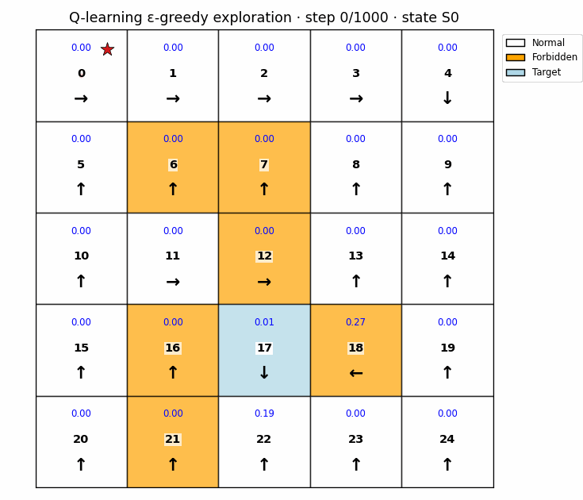

# Foundations-of-RL-Learning-From-Scratch

> 🎯 Building Reinforcement Learning Foundation Algorithms from Scratch | 🧠 Understanding the Core Principles and Practices of Classical RL Algorithms

[]()
[](LICENSE)
[](https://www.python.org/downloads/)
[]()

[English](README_en.md) | [简体中文](README.md)

---

## 📋 Table of Contents
- [🌟 Project Introduction](#-project-introduction)
- [✨ Project Highlights](#-project-highlights)
- [📚 Knowledge Summary Documents](#-knowledge-summary-documents)
- [🚀 Quick Start](#-quick-start)
- [🧩 Environment and Dependencies](#-environment-and-dependencies)
- [🧭 GridWorld Exploration and Interactive Visualization](#-gridworld-exploration-and-interactive-visualization)
- [🧠 Chapter 9: From Classical RL to LLM RL](#-chapter-9-from-classical-rl-to-llm-rl)
- [🏗️ Project Structure & Algorithm Overview](#-project-structure--algorithm-overview)
- [📖 Key Learning Resources](#-key-learning-resources)
- [📄 License](#-license)

## 🌟 Project Introduction

### 📈 Why Learn Reinforcement Learning?

In recent years, Reinforcement Learning (RL) has become a shining star in the field of Large Language Models (LLM), from ChatGPT's RLHF (Reinforcement Learning from Human Feedback) o1 series to DeepSeek's R1 series. RL has become a key technology for improving the alignment, safety, and reasoning capabilities of large language models. However, to deeply understand how modern RL trains LLMs, the best approach is to start from the beginning and learn the evolutionary path of classic RL algorithms.

**Foundations-of-RL-Learning-From-Scratch** is an educational, from-scratch implementation library of foundational reinforcement learning algorithms. The goal of this project is: **to help learners intuitively understand the principles, derivations, and implementation details of core RL algorithms through concise, clear, and runnable code**.

Starting from the basic grid world environment and Bellman equations, the project gradually implements policy iteration, value iteration, Monte Carlo methods, temporal-difference learning, value function approximation, and policy gradients. Chapter 9 then presents educational PPO and GRPO flows for language models. The first eight chapters' experiment modules include:
- 📖 **Complete code implementation** with **detailed annotations**
- 💻 **Executable test examples**
- 🛠️ **Support for adjusting key parameters** (e.g., learning rate, discount factor, exploration rate)
- 📊 **Visualization of the learning process and results**
- 📚 **Bilingual knowledge-summary PDF documents**: systematic summaries of each chapter's theory, code implementation, experiment setup, and result interpretation, helping readers build a traditional RL foundation for later LLM RL study.

## ✨ Project Highlights
- **Code-Driven Learning**: Reject the "black box" approach; each algorithm is implemented step-by-step with code that can be debugged line by line.
- **Unified Grid World Environment**: GridWorld algorithms in the first eight chapters can be compared in a simple shared environment; Chapter 9 uses GSM8K separately.
- **Clear Structure, Progressive Learning**: Chapter organization follows the learning path of classic textbooks, from basics to advanced topics.
- **Theory Meets Practice**: Code implementations are closely aligned with authoritative textbooks like "Mathematical Foundations of Reinforcement Learning".
- **Bilingual Learning Notes**: Newly added Chinese and English PDF documents summarize each chapter around theory, implementation, experimental purpose, and result analysis.

## 🧭 GridWorld Exploration and Interactive Visualization

The animation below shows one ε-greedy exploration trace from the Chapter 6 Q-learning agent. The red line marks the path so far and the red star marks the agent. The colors match the original Chapter 1 GridWorld visualization: white for normal states, orange for forbidden states, and light blue for the target.



To run algorithms from the other chapters interactively, start the panel from the repository root:

```bash
pip install -r requirements.txt
streamlit run apps/gridworld_lab/app.py
```

Select a chapter and algorithm in the left panel. You can adjust grid size, start, goal and penalty states, rewards, discount factor, learning rate, exploration rate, and episode count. Grid colors identify state types, blue cell values show each algorithm's state-value estimate or action-value summary, arrows show policy actions, and the red line shows the agent trajectory. Use the step slider to replay it; training algorithms also show episode returns. Click “生成当前实验 GIF” to play and download an animation using the current parameters. The first eight chapter READMEs include representative algorithm GIFs generated with their Bash script defaults; the original experimental PNG figures remain available. Chapter 5 retains its stochastic-optimization experiment and displays the parameter path and error curve for SGD, Mini-batch GD, or Batch GD.

## 🧠 Chapter 9: From Classical RL to LLM RL

The new [Chapter 9 on PPO and GRPO with GSM8K](Chapter9_LLM_RL_GSM8K/README_en.md) connects policy gradients, value functions, and advantage estimation to language-model training. Its default model is `Qwen/Qwen2.5-0.5B-Instruct`. It includes bilingual notes, a standalone `torch`/`transformers` requirements file, data-download, training, and evaluation entry points, and two **original animated flow diagrams**: [PPO](Chapter9_LLM_RL_GSM8K/assets/ppo_training_flow.gif) and [GRPO](Chapter9_LLM_RL_GSM8K/assets/grpo_training_flow.gif).

| Method | From the same prompt | Advantage and update |
| :--- | :--- | :--- |
| PPO | Sample one answer; check the final number and reference-policy KL | Value head and GAE; clipped policy and value updates |
| GRPO | Sample a group of answers; check each final number | Group-relative rewards; clipped policy update without a value head |

Chapter 9 is a teaching example outside the GridWorld panel. **Model download, end-to-end training, and results have not been verified**; the answers and rewards in its GIFs are illustrative. See the [chapter README](Chapter9_LLM_RL_GSM8K/README_en.md) for usage.

## 📚 Knowledge Summary Documents

To help readers understand the project more completely, the repository now includes bilingual knowledge-summary PDF documents. Starting from the foundations of traditional reinforcement learning, these documents connect each chapter's code and experiments with core topics such as MDPs, Bellman equations, dynamic programming, Monte Carlo methods, TD learning, value function approximation, and policy gradients. They are also intended to provide a theoretical foundation for understanding reinforcement learning in LLM training.

| Language | Document | Description |
| :--- | :--- | :--- |
| Chinese | `docs/Foundations_of_RL_Learning_CN.pdf` | Complete Chinese guide to the theory and experiments. |
| English | `docs/Foundations_of_RL_Learning_EN.pdf` | English guide covering the same theory, implementation, and experiment analysis. |

## 🚀 Quick Start

### 1. Clone the Repository

```bash
git clone https://github.com/tequila28/Foundations-of-RL-Learning.git
cd Foundations-of-RL-Learning
```

### 2. Create Environment and Install Dependencies
It is recommended to use `conda` or `venv` for environment management.

```bash
conda create -n rl_learning python=3.9 -y
conda activate rl_learning
```
```bash
python -m venv rl_learning
source rl_learning/bin/activate # Linux/Mac
```

### 3. Install Python Dependencies

The project root now provides a `requirements.txt` file. The recommended installation command is:

```bash
pip install --upgrade pip
pip install -r requirements.txt
```

You can also install the dependencies manually:

```bash
pip install -r requirements.txt
```

> If you need the GPU version of PyTorch, please install the proper build for your CUDA version from the [official PyTorch installation guide](https://pytorch.org/get-started/locally/).

### 4. Launch the interactive learning lab

The panel brings experiments from all eight chapters into one page. Adjust the GridWorld, episode count, learning rate, exploration rate, and other parameters, then inspect state values, policy directions, episode returns, and agent trajectories. Chapter 5 retains its original two-dimensional mean-estimation task and compares parameter paths for SGD, Mini-batch GD, and Batch GD.

Run this command from the repository root:

```bash
streamlit run apps/gridworld_lab/app.py
```

Open the local address printed by Streamlit in your browser. The original command-line scripts in each chapter remain available.

## 🧩 Environment and Dependencies

Recommended environment:

| Item | Recommended Configuration |
| :--- | :--- |
| Python | 3.9 or later |
| NumPy | Numerical computation, matrix operations, and random sampling |
| Matplotlib | GridWorld plots, value functions, and training curves |
| tqdm | Progress bars during training |
| PyTorch | Policy-gradient and Actor-Critic neural network implementations in Chapter 8 |
| Transformers | Language-model loading, generation, and PPO/GRPO examples in Chapter 9 |
| Streamlit | Interactive learning panel |
| Pillow | Export the GIF animation shown in the README |

Dependency file:

```bash
requirements.txt
```

It contains:

```text
numpy>=1.24
matplotlib>=3.7
tqdm>=4.66
torch>=2.2
transformers>=4.45,<5
streamlit>=1.35
pillow>=10.0
```

## 🏗️ Project Structure & Algorithm Overview

```text
Foundations-of-RL-Learning/
├── apps/
│   └── gridworld_lab/       # Cross-chapter interactive experiment panel
│       ├── app.py           # Page and parameter controls
│       ├── runner.py        # Chapter experiment dispatch
│       ├── common.py        # Shared environment and policy helpers
│       ├── chapters/        # Independent runners for Chapters 1–8
│       ├── visualize.py     # GridWorld and optimizer plots
│       ├── generate_agent_gif.py
│       ├── generate_previews.py
│       ├── assets/          # README animation
│       └── README.md        # App development notes
├── Chapter1_.../            # Chapter algorithms, scripts, docs, and results
├── ...
├── Chapter8_.../
├── Chapter9_LLM_RL_GSM8K/ # PPO and GRPO teaching examples on GSM8K
└── requirements.txt
```

The new panel separates its interface, experiment dispatch, and plotting so contributors can extend them independently. Existing chapter source code, scripts, and result folders stay in their current locations.

The project is organized into different chapters based on core concepts and algorithm categories:

| Algorithm | Status | Location | Core Description |
| :--- | :---: | :--- | :--- |
| **Grid World Environment** | ✅ | `Chapter1_Basic_Concepts/` | Unified simulation environment for testing all algorithms. |
| **Bellman Equations** | ✅ | `Chapter2_Bellman_Equations/` | The core recursive equations of RL, foundational for value computation. |
| **Policy Iteration** | ✅ | `Chapter3_Policy_and_Value_Iteration/` | Classic DP algorithm: alternating iterations of policy evaluation and policy improvement. |
| **Value Iteration** | ✅ | `Chapter3_Policy_and_Value_Iteration/` | A more efficient DP method that directly iterates the value function to optimality. |
| **Monte Carlo Methods (MC)** | ✅ | `Chapter4_Monte_Carlo/` | Model-free prediction and control based on complete episode sampling. |
| **Stochastic Approximation & Optimization** | ✅ | `Chapter5_Stochastic_Approximation/` | Implements optimizers like SGD, BGD, laying the groundwork for subsequent algorithms. |
| **Temporal-Difference Learning (TD Learning)** | ✅ | `Chapter6_Temporal_Difference/` | Includes core algorithms like TD(0), SARSA, and Q-learning. |
| **Value Function Approximation** | ✅ | `Chapter7_Value_Function_Approximation/` | Approximates value functions for large-scale/continuous states using linear functions or neural networks. |
| **Policy Gradient Methods** | ✅ | `Chapter8_Policy_Gradient/`  | Algorithms that directly optimize the policy, such as REINFORCE and Actor-Critic. |
| **PPO and GRPO for LLMs** | 📝 Teaching example | [`Chapter9_LLM_RL_GSM8K/`](Chapter9_LLM_RL_GSM8K/README_en.md) | Reward, advantage estimation, and policy updates with GSM8K and Qwen2.5-0.5B-Instruct; full training has not been verified. |

> Each chapter directory typically contains: algorithm implementation files (`.py`), demo/execution scripts, necessary documentation (`README.md`), and visualization results.

## 📖 Key Learning Resources

The learning and implementation of this project are greatly inspired by the following high-quality open-source resources. They are highly recommended for combined study with the code:

1.  **Core Textbook**:
    🔗 **[《Mathematical Foundations of Reinforcement Learning》](https://github.com/MathFoundationRL/Book-Mathematical-Foundation-of-Reinforcement-Learning)** - Authored by Prof. Shiyu Zhao from Westlake University. This book systematically explains RL from a mathematical perspective. It is logically rigorous, uses a grid world throughout, and is an excellent guide for understanding the principles behind the algorithms. The GitHub repository contains all resources including the book PDF and lecture slides.

2.  **Complementary Video Course**:
    🔗 **[【Mathematical Foundations of Reinforcement Learning】Course](https://www.bilibili.com/video/BV1sd4y167NS)** - A complete video course (on Bilibili platform) complementing the textbook. Video explanations help visualize complex concepts.

## 📄 License

This project is open source under the MIT License. See the [LICENSE](LICENSE) file for details.
